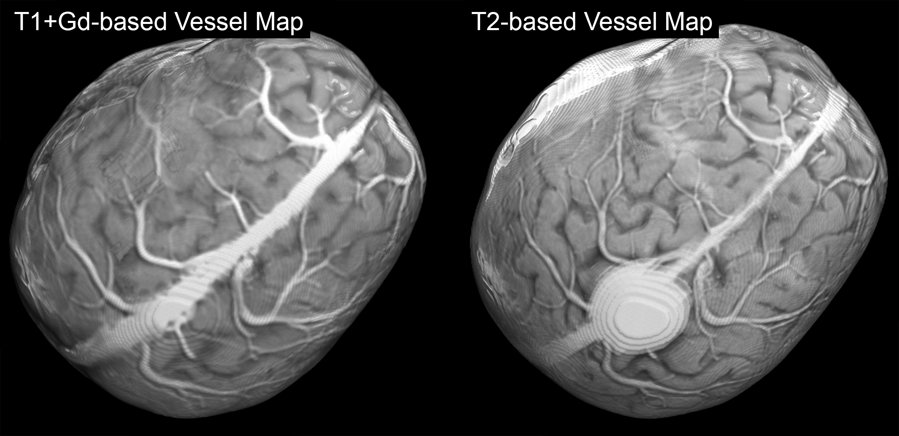

# t2_vessel_view




## Overview
T2 Vessel View generates 'T2 Vessel Maps' based on 2D T2-weighted, T1 and FLAIR images. It outputs processed images eroded to a series of depths from the cortical surface, and annotated multi-modality and multi-angle displays as .pptx files. Validation of the methodology is described in [this paper](https://www.sciencedirect.com/science/article/abs/pii/S0967586825006290).

This package is not for clinical diagnostic use.

## Features
- **Automatic format detection**: DICOM or NIfTI input
- **Masking**: Brain mask generation with optional convex hull
- **3D volume rendering**: MRIcroGL 
- **QC outputs**: 2D mask overlays


## Installation
```bash
conda env create -f t2vv_env.yml -n t2vv
conda activate t2vv
# or, from source
pip install -e .
```

### Linux pip-first install (no sudo)
If `conda env create` is slow/hangs, a pip-first workflow is supported:
```bash
conda create -n t2vv python=3.10 -y
conda activate t2vv
pip install -r requirements.txt
pip install -e .
```

For Linux, dependencies include `pyvips-binary`, which provides bundled libvips for `pyvips` usage without system-level install.

Tested on macOS; Python version as per `t2vv_env.yml`/`pyproject.toml`.

## Quick start
```bash
conda activate t2vv

# (Optional) Point to your MRIcroGL executable (macOS default shown)
export T2VV_MRICROGL_PATH="/Applications/MRIcroGL.app/Contents/MacOS/MRIcroGL"

# Show command line help
python -m t2vesselviewcode.t2_vessel_view_main -h
```

By default the main command **preprocesses and erodes only** (no PPTX panels).
Generate displays afterward with `t2vv_render_existing --panels ...`, or pass
`--panels` on the main command for a one-shot run.

### If the package asks you to "set a path"
Copy/paste these commands in Terminal before running the pipeline.

1) Find the MRIcroGL executable (Linux/macOS):
```bash
command -v MRIcroGL || command -v mricrogl || command -v MRIcroGL_QT
```

2) Set MRIcroGL path for the current terminal session:
```bash
export T2VV_MRICROGL_PATH="/full/path/from-command-above"
```

3) Run the pipeline command in the same terminal.

To make these settings permanent, add the `export ...` lines to `~/.bashrc`, then run:
```bash
source ~/.bashrc
```

## Usage
### Minimal run (preprocess / erode only)
```bash
python -m t2vesselviewcode.t2_vessel_view_main \
  -d /path/to/mri_dir \
  -i /path/to/T1_raw.nii.gz
```

### Minimal run with optional FLAIR
```bash
python -m t2vesselviewcode.t2_vessel_view_main \
  -d /path/to/mri_dir \
  -i /path/to/T1_raw.nii.gz \
  -f /path/to/FLAIR.nii.gz
```

### Typical preprocess run (with T2 series)
```bash
python -m t2vesselviewcode.t2_vessel_view_main \
  -d /path/to/mri_dir \
  -o /path/to/output_dir \
  -i /path/to/T1_raw.nii.gz \
  -f /path/to/FLAIR.nii.gz \
  -s /path/to/T2_tse_sag.nii.gz \
  -c /path/to/T2_tse_cor.nii.gz \
  -t /path/to/T2_tse_tra.nii.gz
```

### Generate display panels from an existing output folder
```bash
# Structural panels (T1, T2, multimodal)
t2vv_render_existing --source-dir /path/to/output_dir/T2VesselView_* --panels standard

# T1 + overlay (e.g. PET)
t2vv_render_existing --source-dir /path/to/output_dir/T2VesselView_* \
  --panels t1_overlay_overview \
  --overlay1-path /path/to/PET.nii.gz \
  --overlay1-name PET \
  --overlay1-color green \
  --overlay1-min 0 --overlay1-max 5

# YAML-configured 2–4 column custom overlay panel
t2vv_render_existing --source-dir /path/to/output_dir/T2VesselView_* \
  --panels custom_overlay_trio \
  --panel-config /path/to/custom_overlay_trio.yaml
```

Copy `examples/custom_overlay_trio.yaml` as a starting point. Custom panel
overlays must already be aligned with the structural images. The YAML supports
T1, automatically selected T2, and FLAIR bases; cardinal/surgical views; overlay
colour, opacity and window values; all erosion depths; and slice sweeps. Overlays
are optional for each slot, so a slot can display only its structural base.

### One-shot: preprocess and panels in a single command
```bash
python -m t2vesselviewcode.t2_vessel_view_main \
  -d /path/to/mri_dir \
  -o /path/to/output_dir \
  -i /path/to/T1_raw.nii.gz \
  -s /path/to/T2_tse_sag.nii.gz \
  --panels standard
```

### For multiple unilateral sagittal T2 acquisitions
```bash
python -m t2vesselviewcode.t2_vessel_view_main \
  -d /path/to/mri_dir \
  -o /path/to/output_dir \
  -i /path/to/T1_raw.nii.gz \
  -f /path/to/FLAIR.nii.gz \
  --t2_sag_left  /path/to/T2_tse_sag_l.nii.gz \
  --t2_sag_right /path/to/T2_tse_sag_r.nii.gz
```

## Inputs
- **Required**: `-d` MRI directory, `-i` T1 (main structural)
- **Optional**: `-f` FLAIR (3D). Required only when `--auto-mask-method watershed` is used.
- **Optional**: `-s` T2 sagittal, `-c` T2 coronal, `-t` T2 transverse, `--t2_sag_left`, `--t2_sag_right`, `-p` 3D T2, `-m` user mask, `-n` mask structural, `--use-hull-mask`


## Outputs
- Eroded NIfTI volumes per modality and depth (main command default)
- Optional 3D renders and PPTX panels when `--panels` is set (or via `t2vv_render_existing`)
- QC overlays (mask vs anatomy)

## Configuration
- **MRIcroGL path**: set `T2VV_MRICROGL_PATH` to the executable if not in default location
- **Environment**: run inside the `t2vv` conda environment

## Troubleshooting
- MRIcroGL not found: set `T2VV_MRICROGL_PATH`
- File format/orientation: ensure valid NIfTI/DICOM; see validation messages
- Memory/rendering issues: reduce image size or close other apps

## License 

