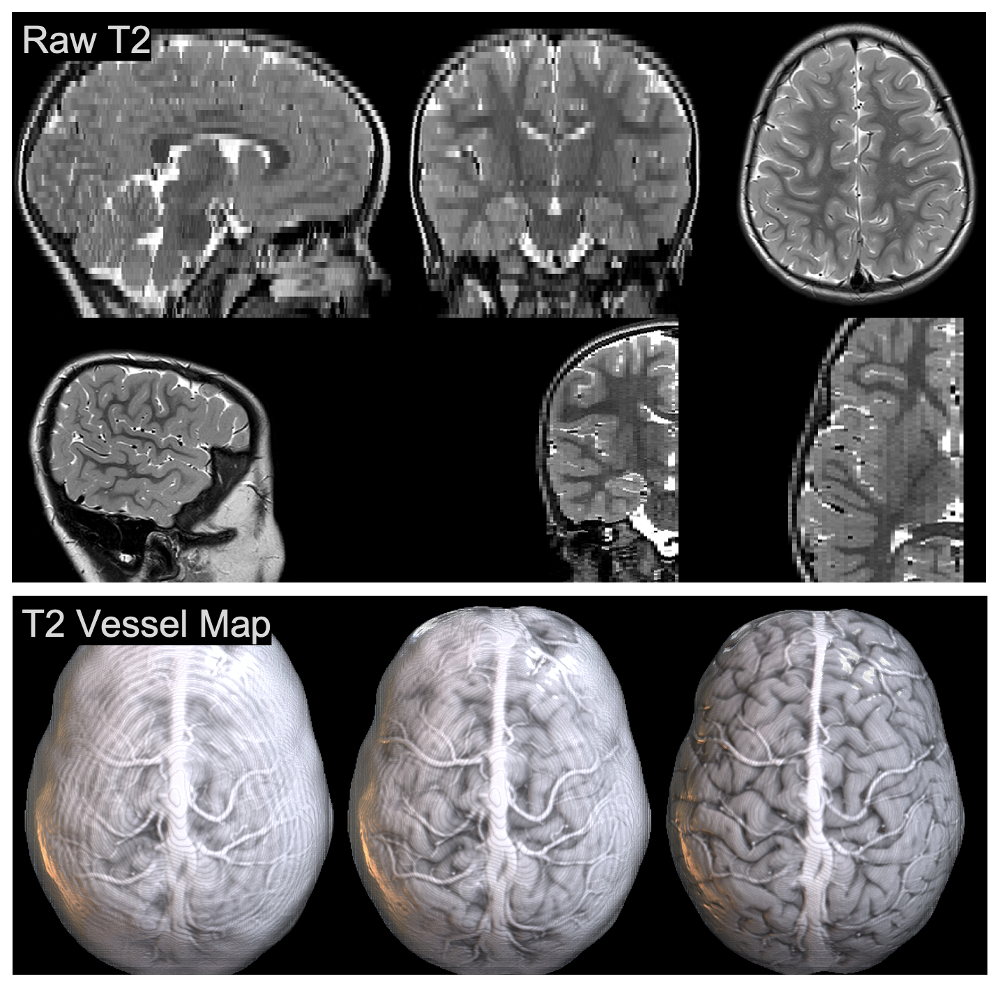
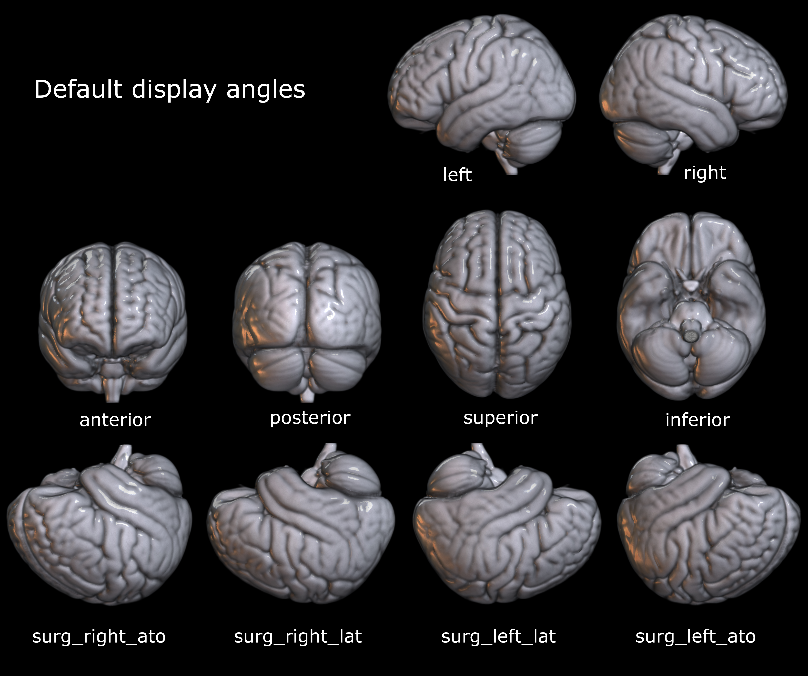

# t2_vessel_view




## Overview
T2 Vessel View generates 'T2 Vessel Maps' based on 2D T2-weighted, T1 and FLAIR images. It outputs processed images eroded to a series of depths from the cortical surface, and annotated multi-modality and multi-angle displays as .pptx files. Validation of the methodology is described in [this paper](https://www.sciencedirect.com/science/article/abs/pii/S0967586825006290).

This package is not for clinical diagnostic use.

## Features
- **Automatic format detection**: DICOM or NIfTI input
- **Masking**: Brain mask generation with optional convex hull
- **3D volume rendering**: MRIcroGL 
- **QC outputs**: 2D mask overlays


## Installation
Clone the repository, then run the installation commands from its root
directory:

```bash
git clone https://github.com/NACIS-RCH/t2_vessel_view.git
cd t2_vessel_view
conda env create -f t2vv_env.yml
conda activate t2vv
python -m pip install .
```

### Alternative Linux installation from source
If resolving the full Conda environment is slow, create a minimal Conda
environment and install the Python dependencies with pip. Run these commands
from the repository root:

```bash
conda create -n t2vv python=3.10 -y
conda activate t2vv
python -m pip install --upgrade pip
python -m pip install .
```

For Linux, dependencies include `pyvips-binary`, which provides bundled libvips for `pyvips` usage without system-level install.
The Python installation above does not require `sudo`; FSL and MRIcroGL are
external applications and must be installed separately when needed.

### Developer installation
Developers who want source-code changes to take effect without reinstalling the
package can use editable mode from the repository root:

```bash
conda activate t2vv
python -m pip install -e .
```

Tested on macOS and Linux; Python version as per `t2vv_env.yml`/`pyproject.toml`.

### FSL external dependency
FSL is not installed by pip or by this package. The main preprocessing workflow
requires both the `bet` and `robustfov` commands. Install FSL using the
[official FSL installation instructions](https://fsl.fmrib.ox.ac.uk/fsl/docs/#/install/index),
then verify that both commands are available:

```bash
command -v bet
command -v robustfov
```

FSL is not required when using `t2vv_render_existing` to render outputs that
have already been preprocessed.

### MRIcroGL external dependency
MRIcroGL is an external application and is not installed by pip or conda with
this package.

- **Preprocessing and erosion only:** MRIcroGL is not required. The startup
  check reports a warning if it is unavailable, then continues and writes the
  eroded NIfTI outputs.
- **Display panels and render-existing runs:** MRIcroGL is required. The
  command stops before processing or rendering if it cannot locate a usable
  executable.

The startup check always reports whether MRIcroGL rendering is available, so a
user does not unknowingly complete preprocessing and expect unavailable panel
outputs.

## Quick start
```bash
conda activate t2vv

# (Optional) Point to your MRIcroGL executable when generating renders (macOS default shown)
export T2VV_MRICROGL_PATH="/Applications/MRIcroGL.app/Contents/MacOS/MRIcroGL"

# Show command line help
python -m t2vesselviewcode.t2_vessel_view_main -h
```

By default the main command **preprocesses and erodes only** (no PPTX panels).
Generate displays afterward with `t2vv_render_existing --panels ...`, or pass
`--panels` on the main command for a one-shot run.

### If the package asks you to "set a path"
Copy/paste these commands in Terminal before running the pipeline.

1) Find the MRIcroGL executable (Linux/macOS):
```bash
command -v MRIcroGL || command -v mricrogl || command -v MRIcroGL_QT
```

On Linux, MRIcroGL may first need to be loaded through the local
module system or installed in a user-accessible location. Ask the
administrator for the executable path if the command above returns nothing.

2) Set MRIcroGL path for the current terminal session:
```bash
export T2VV_MRICROGL_PATH="/full/path/from-command-above"
```

3) Run the pipeline command in the same terminal.

To make these settings permanent, add the `export ...` lines to `~/.bashrc`, then run:
```bash
source ~/.bashrc
```

## Usage
### Minimal run (preprocess / erode only)
```bash
python -m t2vesselviewcode.t2_vessel_view_main \
  -d /path/to/mri_dir \
  -i /path/to/T1_raw.nii.gz
```

### Minimal run with optional FLAIR
```bash
python -m t2vesselviewcode.t2_vessel_view_main \
  -d /path/to/mri_dir \
  -i /path/to/T1_raw.nii.gz \
  -f /path/to/FLAIR.nii.gz
```

### Typical preprocess run (with T2 series)
```bash
python -m t2vesselviewcode.t2_vessel_view_main \
  -d /path/to/mri_dir \
  -o /path/to/output_dir \
  -i /path/to/T1.nii.gz \
  -f /path/to/FLAIR.nii.gz \
  -s /path/to/T2_sag.nii.gz \
  -c /path/to/T2_cor.nii.gz \
  -t /path/to/T2_tra.nii.gz
```

### Generate display panels from an existing output folder
```bash
# Structural panels (T1, T2, multimodal)
t2vv_render_existing --source-dir /path/to/output_dir/T2VesselView_* --panels standard

# T1 + overlay (e.g. PET)
t2vv_render_existing --source-dir /path/to/output_dir/T2VesselView_* \
  --panels t1_overlay_overview \
  --overlay1-path /path/to/PET.nii.gz \
  --overlay1-name PET \
  --overlay1-color jet \
  --overlay1-min 2000 --overlay1-max 20000

# YAML-configured 2–4 column custom overlay panel
t2vv_render_existing --source-dir /path/to/output_dir/T2VesselView_* \
  --panels custom_overlay_panels \
  --panel-config /path/to/custom_overlay_panels.yaml
```

Copy `examples/custom_overlay_panels.yaml` as a starting point. Custom panel
overlays must already be aligned with the structural images. The YAML supports
T1, automatically selected T2, and FLAIR bases; cardinal/surgical views; overlay
colour, opacity and window values; all erosion depths; and slice sweeps. Overlays
are optional for each slot, so a slot can display only its structural base.
Custom erosion composites are saved at every depth; slice sweeps use the single
YAML `slice_erode_depth` (default `35`, corresponding to prefix `035`). For left/right
sagittal, surgical and ATO views, custom T2 selection prefers the matching-side
sagittal acquisition, then a generic sagittal acquisition; it never substitutes
the opposite-side sagittal acquisition.

Custom YAML can use the existing one-row `slots:` list (2–4 slots), or two
explicit rows with 1–4 slots each:

```yaml
rows:
  top:
    - base: t1
    - base: t1_gd
  bottom:
    - base: flair
    - base: t2
```

If row lengths differ, both rows are left-aligned and the wider row determines
the final panel width.

Set the custom PowerPoint filename in YAML with a basename or optional extension:

```yaml
pptx_name: longitudinal_comparison
```

This writes `PowerPoints/longitudinal_comparison.pptx`. Paths are not accepted.


### Default display angles




### User-specified display and slice angles

Add new (non-preset) camera directions with repeatable CLI options:

```bash
t2vv_render_existing \
  --source-dir /path/to/T2VesselView \
  --panels custom_overlay_panels \
  --panel-config /path/to/custom_overlay_panels.yaml \
  --display-angle my_view 240 170 \
  --slice-plane my_view 120 0
```

`--display-angle LABEL AZ EL` is always required. A matching `--slice-plane`
is required when QMM or the custom YAML panel is requested; display-only angles
are allowed for standard raw volume renders. New labels are appended
automatically and cannot override preset names. Standard stitched overview
layouts remain unchanged, so their new angles are raw `by_angle/LABEL` outputs.

For a custom angle’s T2 source, display azimuth/elevation is compared with the
existing camera directions using spherical angular distance. An unambiguous
nearest direction inherits its normal T2/laterality rule. Exact ties prefer T2
3D, then use the documented data-aware sagittal/transverse/coronal rules; an
opposite-side unilateral sagittal image is never substituted. Slice-plane
values do not affect T2 source selection.

### Named extra structural images

Repeat `--extra-image NAME=PATH` to preprocess additional T1-like images such
as post-contrast or T1 from different acquisition:

```bash
t2vesselview \
  -d /path/to/mri_dir \
  -i /path/to/current_T1.nii.gz \
  --extra-image t1_gd=/path/to/T1_Gd.nii.gz \
  --extra-image t1_prior=/path/to/extra_T1.nii.gz
```

Each extra is reoriented, N4-corrected, affine registered to the main T1, and
eroded with the same masks. Outputs are stored under
`Processing/Preprocessed_Extra/NAME` and `Eroded_nifti/Extra/NAME`. An existing
extra can be selected directly in a custom panel with `base: t1_gd`. Extras use
the normal T1 structural windowing; quantitative maps and segmentations should
remain overlay inputs instead.

### One-shot: preprocess and panels in a single command
```bash
python -m t2vesselviewcode.t2_vessel_view_main \
  -d /path/to/mri_dir \
  -o /path/to/output_dir \
  -i /path/to/T1_raw.nii.gz \
  -s /path/to/T2_tse_sag.nii.gz \
  --panels standard
```

### For multiple unilateral sagittal T2 acquisitions
```bash
python -m t2vesselviewcode.t2_vessel_view_main \
  -d /path/to/mri_dir \
  -o /path/to/output_dir \
  -i /path/to/T1.nii.gz \
  -f /path/to/FLAIR.nii.gz \
  --t2_sag_left  /path/to/T2_sag_l.nii.gz \
  --t2_sag_right /path/to/T2_sag_r.nii.gz
```

## Inputs
- **Required**: `-d` MRI directory, `-i` T1 (main structural)
- **Optional**: `-f` FLAIR (3D). Required only when `--auto-mask-method watershed` is used.
- **Optional**: `-s` T2 sagittal, `-c` T2 coronal, `-t` T2 transverse, `--t2_sag_left`, `--t2_sag_right`, `-p` 3D T2, `-m` user mask, `-n` mask structural, `--use-hull-mask`
- **Optional repeatable**: `--extra-image NAME=PATH` for additional T1-like structural images registered to the main T1


## Outputs
- Eroded NIfTI volumes per modality and depth (main command default)
- Optional 3D renders and PPTX panels when `--panels` is set (or via `t2vv_render_existing`)
- QC overlays (mask vs anatomy)

## Configuration
- **MRIcroGL path**: set `T2VV_MRICROGL_PATH` to the executable if not in default location
- **Environment**: run inside the `t2vv` conda environment

## Troubleshooting
- MRIcroGL not found: set `T2VV_MRICROGL_PATH`
- File format/orientation: ensure valid NIfTI/DICOM; see validation messages
- Memory/rendering issues: reduce image size or close other apps

## License 

This project is licensed under the MIT License. See [LICENSE](LICENSE).